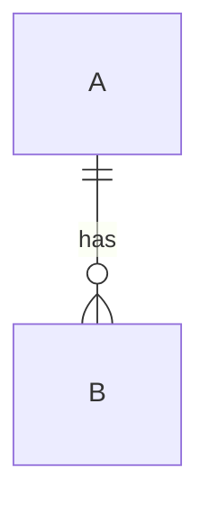

# 配置设计说明：{{系统名称}}

- 底座：{{base id}}
- 日期：{{YYYY-MM-DD}}
- 关联需求：{{文档链接/路径}}

## 1. 结论

{{需要新增/修改哪些表，一句话}}

## 2. 运行时状态

| 状态 | 进入条件 | 退出条件 | 持久化 |
| --- | --- | --- | --- |
| | | | |

## 3. 实体关系

| 实体 | 主键 | 关键属性 | 关系 |
| --- | --- | --- | --- |
| | | | |

## 4. 表结构

### 4.1 {{表名}}

| 字段 | 类型 | 必填 | 默认值 | 说明 | 引用 |
| --- | --- | --- | --- | --- | --- |
| | | | | | |

### 4.2 {{表名}}

| 字段 | 类型 | 必填 | 默认值 | 说明 | 引用 |
| --- | --- | --- | --- | --- | --- |
| | | | | | |

## 5. 引用链检查

| 引用 | 目标 | 是否存在 | 消费方 | 删除影响 |
| --- | --- | --- | --- | --- |
| | | | | |

## 6. 验收用例

| # | 类型 | 输入 | 期望结果 | 检查方式 |
| --- | --- | --- | --- | --- |
| 1 | 正常 | | | |
| 2 | 边界 | | | |
| 3 | 非法 | | | |
| 4 | 状态异常 | | | |
| 5 | 删除/回滚 | | | |

## 7. 变更影响

- 影响系统：
- 影响表：
- 兼容旧数据：
- 灰度/开关：
- 回滚方案：

## 8. 待确认

- 
