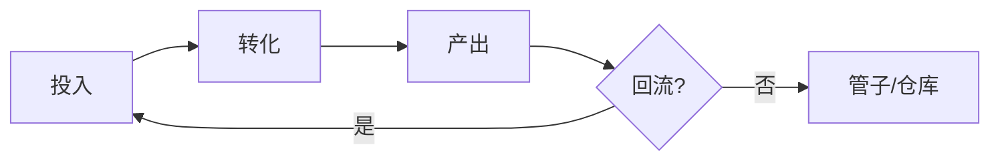

# 系统拆解报告：{{系统名称}}

- 底座：{{base id}}
- 日期：{{YYYY-MM-DD}}
- 拆解对象版本：{{版本/来源}}

## 1. 结论

{{一句话：成不成立，断在哪}}

## 2. 定位

| 项 | 内容 |
| --- | --- |
| 主角色 | 生存锚点 / 生产转化 / 进度结晶 / 身份表达 |
| 服务循环 | 生存 / 生产 / 战斗 / 社交 |
| 改变的状态 | |
| 制造的决策 | |
| 产出与消费方 | |

## 3. 循环图

断点：{{位置与原因}}

## 4. 三轴判定

| 轴 | 判定 | 证据 |
| --- | --- | --- |
| 价值轴（循环/管子） | | |
| 时间轴（正资产/僵尸） | | |
| 操作轴（O(1)/O(N×k)） | | |

## 5. 失败模式

| 模式 | 命中 | 证据 | 严重度 |
| --- | --- | --- | --- |
| 管子非循环 | | | |
| 僵尸系统 | | | |
| 操作粒度泄漏 | | | |
| 两端爽点混搭 | | | |
| 其他 | | | |

## 6. 配置落点

| 表/Sheet | 字段 | 作用 | 缺口 |
| --- | --- | --- | --- |

> 当前底座未收录的配置信息写“未收录”，不要编造。

## 7. 风险

| 风险 | 类型 | 影响 | 证据级别 |
| --- | --- | --- | --- |

## 8. 最小验证

- 假设：
- 方法：
- 指标：
- 判定标准：

## 9. 行动项

| 行动 | 负责人 | 时点 | 完成标准 |
| --- | --- | --- | --- |
