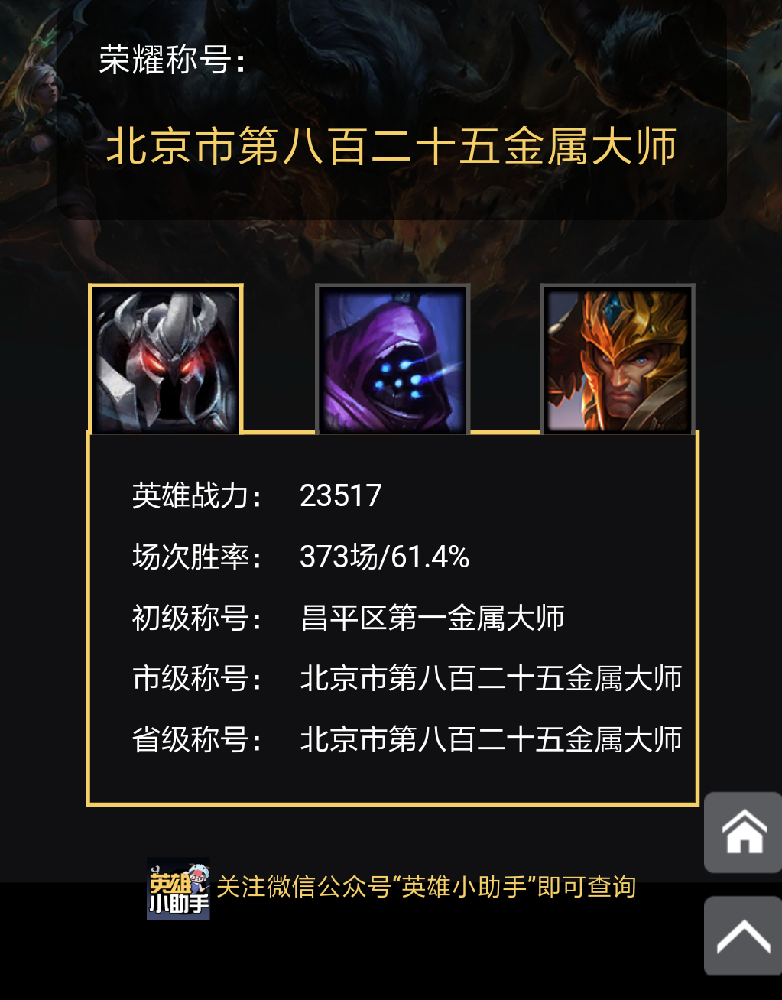
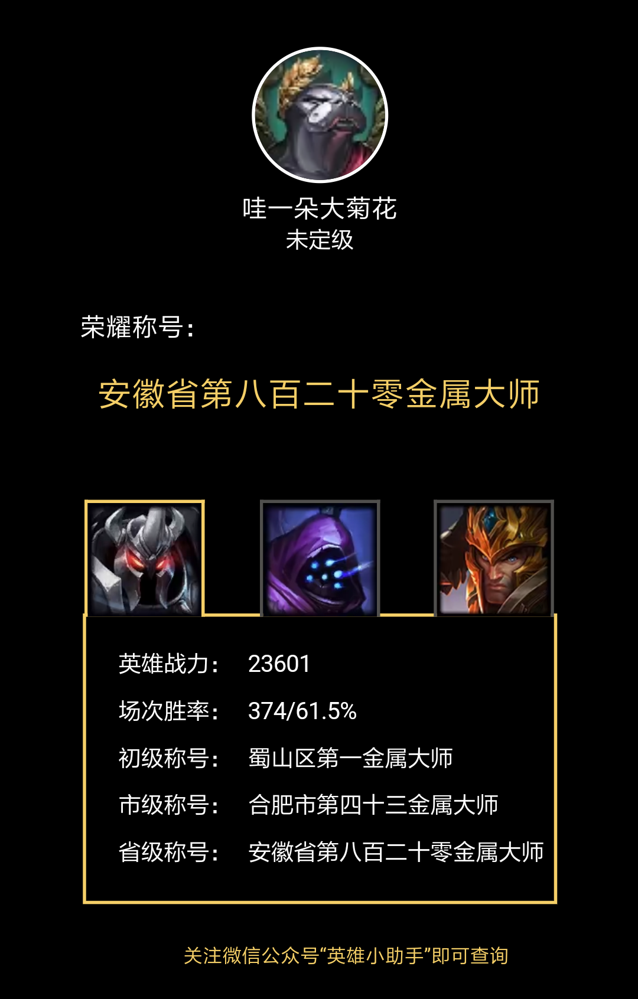

# 游戏设计思考录

> 游戏策划分析与技术学习的综合笔记
> 涵盖数值设计、系统策划、开发方法论与编程实践

---

## 🎮 系统设计理论

### 📐 SOC 系统设计方法论（7 篇）

一套「沙盒生存游戏的设计尺子」。全部是<b>可迁移内核</b>——项目事实只在浅案例里作佐证，不当标准。每篇含定位三问、四种「设计死法」诊断器与决策检查清单。

<a class="method-index" href="{{ '/soc-methodology/' | relative_url }}">总览与使用顺序　先答灵魂问题 → 定位三问 → 四死法诊断 → 按题材查手册</a>

<ul class="method-list">
  <li>
    <a class="method-name" href="{{ '/soc-methodology/家园系统方法论' | relative_url }}">家园系统</a>
    家园 = 成长循环载体，非仓库；双轨成长轴
  </li>
  <li>
    <a class="method-name" href="{{ '/soc-methodology/载具平台系统方法论' | relative_url }}">载具平台</a>
    平台 = 能力放大器 + 依赖链四漏勺
  </li>
  <li>
    <a class="method-name" href="{{ '/soc-methodology/玩法循环方法论' | relative_url }}">玩法循环</a>
    产能 = 风险阀门 + 零和掠夺 + 正和养成回收
  </li>
  <li>
    <a class="method-name" href="{{ '/soc-methodology/生存属性系统方法论' | relative_url }}">生存属性</a>
    属性三层骨架 + 互转兑换表
  </li>
  <li>
    <a class="method-name" href="{{ '/soc-methodology/采集链路方法论' | relative_url }}">采集链路</a>
    先定操作粒度；采集三要素
  </li>
  <li>
    <a class="method-name" href="{{ '/soc-methodology/射击战斗方法论' | relative_url }}">射击战斗</a>
    手感词条化 + 部位万分比 + 耗材净支出
  </li>
  <li>
    <a class="method-name" href="{{ '/soc-methodology/交互易用性方法论' | relative_url }}">交互易用性</a>
    优化即减摩；四维判据
  </li>
</ul>

### 🔍 其他系统设计思考

**1. [使用OpenClaw进行多agent辅助游戏设计的思考](04-reaction-mode-design)**

从多Agent协作的角度，探讨了Actor-Critic架构在游戏内容设计中的应用，以及强化学习思想对设计Prompt和调度架构的启发。

**2. [游戏反应模式设计策略：运动反应 vs 认知反应的选择与平衡](17-reaction-mode-design.md)** 🚧 *WIP*

从反应模式分析了两类反应类型对应的游戏风格、受众以及数值设计范式区别。

---

## 🕹️ 实践项目

**1. [自由的边界(Papers, Please AI版）](papers-please-ai/)** 🎮

以Lucas Pope开发的《Papers, please》、以及《绝区零》办证件活动玩法为灵感，使用OpenClaw开发的入境审批模拟游戏。玩家扮演米国入境审查官，和AI大模型扮演的不同背景的申请人进行自由对话，决定是否放行。放行结果对游戏结局产生影响，例如拒绝过多留学生导致科技停滞。

**2. [Wireless Communication Journey](https://wvlsinvj.manus.space/)** 🌐

使用Manus开发的网页小游戏，通俗地解释了信息从发送者传输到接收者的全过程及其原理。

**3. [领域智能助手：把项目知识变成可检索的资产](agent-design/)** 🤖

面向游戏策划的领域智能助手设计记录：把需求文档 / 配置表 / 多语言表 / 工程代码 / 预制体组件参数五处数据源接进同一个上下文，封装成可复用的工作流模块，并把每次排查的结论沉淀成可检索的知识。重点在**「可迁移内核」与「项目事实」如何分离**。

---

## 📚 设计思考集

### 📊 数值设计分析及思考

**1. [数值膨胀的升维破局：以明日方舟为例的长线游戏数值设计分析](01-arknights-analysis)**

从升维、退环境、随机、消耗四个角度分析了明日方舟的数值膨胀控制策略，以及提出后续的改进建议。

**2. [随机池过大导致随机体验下降的解决方案](02-random-pool-solution)**

以明日方舟【中坚寻访】为例，提出"分而治之，打标签分组"的方案，改善长线游戏中内容增加，随机池扩大导致的随机体验下降的问题。

**3. [恐怖黎明数值拆解V0.1](03-grim-dawn-analysis.pdf)**

分析了恐怖黎明的战斗数值框架。

### 🤔 开发方法论

**1. [前期开发与后验结果无法获取的矛盾](05-development-paradox.md)**

分析了数值开发时，需要某个后验结果，但初次开发时并没有这个后验结果的困境及其解决方案。

**2. [关于因果性和相关性的一点思考](07-Causality-and-Correlation)**

探讨了如何避免相关性陷阱，通过严格的验证框架将数据相关性转化为可靠的因果性判断，建立游戏开发决策的科学依据。

**3. [主策划团队协作心得：避免后见之明偏差与无意义行为](16-hindsight-bias-and-team-collaboration)**

从认知科学角度深入剖析后见之明偏差（Hindsight Bias）的形成机制，分析为什么"事后质问替代方案"是无意义的行为，总结策划工作中的常见陷阱，并提出建立健康团队文化的实践方法。

### 📖 学习笔记

**1. [Java面向对象编程核心概念总结](08-java-oop-fundamentals-for-game-development)**

总结了在游戏开发中Java面向对象编程的核心概念，包括方法重载、方法重写、设计模式以及与C语言的对比分析。

**2. [不同编程模式的形象化比喻](09-coding-mode-metaphor)**

用生活中的场景对常用的编程模式：轮询、事件驱动、状态机、直接调用，进行了形象描述。

**3. [先升攻还是先升防？](11-attack-defense-priority-analysis)**

通过数学建模分析游戏中攻击力与防御力的升级优先级，提供减法与乘法伤害公式的完整推导过程，并结合星际争霸2实战案例验证理论有效性。

**4. [兰彻斯特方程学习笔记](12-lanchester-laws)**

总结了线性法则和平方法则的兰彻斯特方程及其数学推导，并且纠正了对于分离变量法理解不够到位的地方。

**5. [蒙特卡洛方法学习笔记](13-monte-carlo)**

整理蒙特卡洛方法的数学原理基础，以及在实际生产中的意义：看似"力大砖飞"，实则是复杂系统解析解无法求得情况下的最佳选择。

**6. [马尔科夫链平稳状态的通用求解流程](14-game_markov-chain-steady-state-guide)**

整理了马尔科夫链平稳状态求解的流程，从特征值理论到代码实现，完整解决游戏数值建模中的马尔科夫链平稳状态分析问题。

**7. [AI 秒出答案的时代，先失败才是最好的学习方法](18-productive-failure-ai-learning)**

转载入口与阅读笔记：从有效失败、认知卸载和 AI 辅助学习的角度，整理“先自己试错，再使用 AI”的学习流程。

### 💡 行业观察

**1. [VR/AR娱乐：体验的点缀，而非平面媒体的替代](15-XR-vs-phone)**

从人体工程学、便携性、内容生态等维度分析为什么手机是人类娱乐的终极形态，而VR/AR只能是特定场景下的体验补充。

### 🎯 游戏体验

#### 🏆 游戏成就展示

**崩坏3 - 长期游玩纪录**

**绝区零 - 首发玩家**

**英雄联盟 - 金属大师专精**

- 北京市昌平区第一金属大师

- 合肥市蜀山区第一金属大师

---

## 🔧 关于本站

- **技术栈**: GitHub Pages + Jekyll + MathJax
- **主要内容**: 游戏数值设计、系统策划理论、实战案例分析、产品体验研究
- **更新频率**: 持续更新，记录最新的设计思考

---

## 📱 联系方式

如果你对这些话题感兴趣，或想要交流游戏设计相关问题，欢迎通过以下方式联系：

- 📧 Email: bzcbzc@mail.ustc.edu.cn
- 🐙 GitHub: [https://github.com/ShiroisWhite](https://github.com/ShiroisWhite)

---

*最后更新：{{ site.time | date: "%Y年%m月%d日" }}*
